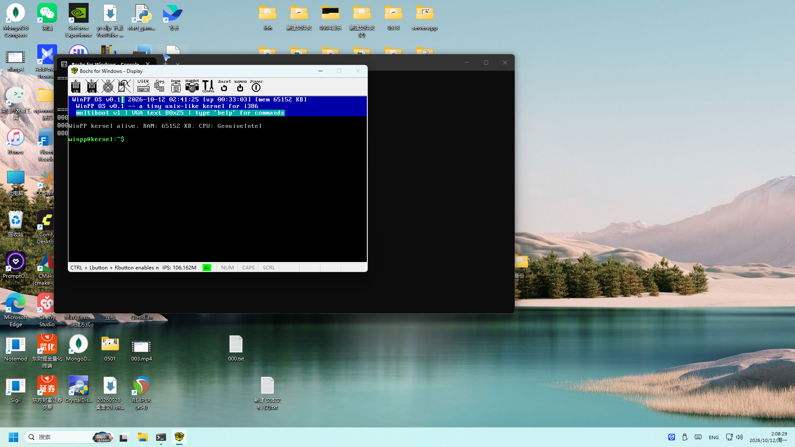

# WinPP OS

> 一个从零写起的 **i386 迷你操作系统内核** —— 能开机、能交互，全部功能在 **Bochs 2.8 实机**逐键验证通过。



WinPP OS 是一份教学级迷你内核：自写 512B 引导扇区（软盘 CHS + Multiboot v1 双引导）、
32 位保护模式、完整 IDT/PIC 中断体系、PIT 定时器、PS/2 键盘、CMOS RTC、COM1 串口、
80×25 VGA 文本驱动，上面跑一个 Unix 风格交互 Shell 和一个可切换窗口的"桌面 UI"演示。

**它不是玩具 PPT，是实机跑起来的内核**：开机 → Shell 提示符 → 逐键输入命令 → 输出上屏；
机器侧真值由内核自己写进 COM1 串口（39 次按键日志 + 14 次命令前后全屏转储 + 0 故障）。

## 仓库结构

```
WinPP/
├── winpp-os/               # 内核本体（源码 + 构建 + 镜像 + 实测证据）
│   ├── src/                # 18 个源文件：引导(ASM) / 内核核心(C) / 驱动(C) / 应用(C)
│   ├── build_flat.ps1      # 构建：bootsec + kernel → floppy.img
│   ├── build.ps1           # 构建：Multiboot ELF
│   ├── floppy.img          # 1.44MB 启动盘镜像（0xAA55 引导扇区 + 41 扇区内核）
│   ├── winpp-kernel.elf    # Multiboot v1 内核（GRUB 真机用）
│   ├── bochsrc.txt         # Bochs 2.8 配置
│   ├── README.md           # 内核详细文档（构建/Bochs 实测/排障记录）
│   ├── serial-evidence.txt # COM1 串口取证档案
│   └── shots/              # 实机截图 01-10 系列
├── deploy/                 # 真机部署包
│   ├── make_grub_usb.sh    # GRUB 启动盘一键制作脚本
│   ├── grub.cfg            # GRUB 菜单模板
│   ├── winpp-kernel.elf    # GRUB 加载的内核
│   ├── floppy.img          # 软盘/老机器直写镜像
│   ├── 部署说明.txt
│   └── U盘启动盘制作与BIOS启动手册.txt
├── assets/                 # 本 README 与详解页引用的实机截图
├── WinPP内核详解.html      # 全解析信息页（语言/底层逻辑/源码/流程/架构/Bug/功能）
├── start-winpp.bat         # 一键启动：Bochs 2.8 加载 floppy.img 开机
└── check-mb.py             # Multiboot 头校验脚本
```

## 快速开始

### 方式一：一键开机（Windows + Bochs 2.8）

```powershell
# 安装 Bochs 2.8 后，双击：
D:\WinPP\start-winpp.bat
# 或手动：Bochs → Load 配置 winpp-os/bochsrc.txt → Start
# 开机后敲：help / time / uptime / sysinfo / demo / reboot
```

### 方式二：重新构建（Zig 0.17 交叉编译）

```powershell
powershell -ExecutionPolicy Bypass -File D:\WinPP\winpp-os\build_flat.ps1
# 产物：floppy.img / kernel.bin（入口 0x100000）
```

### 方式三：真机部署

1. **GRUB（推荐）**：`deploy/make_grub_usb.sh` 在 Linux/Ubuntu Live 环境一键做启动盘
2. **老机器直写**：`floppy.img` 用 Rufus DD 模式写 USB / 写真实软盘
3. 完整步骤见 `deploy/U盘启动盘制作与BIOS启动手册.txt`

## 功能一览

| 类别 | 内容 |
|---|---|
| 引导 | 512B 引导扇区（CHS 读盘→A20→LGDT→保护模式）+ Multiboot v1 双路径 |
| 中断 | 256 门 IDT，32 异常 + 16 IRQ（PIC 重映射），异常带寄存器转储 + Panic 屏 |
| 驱动 | PIT 100Hz / PS/2 键盘（Shift/Caps/E0 方向键）/ CMOS RTC / COM1 串口 / VGA 文本 |
| Shell | 17 条命令：help about echo clear time uptime sysinfo calc color ls demo beep reboot poweroff 等 |
| 窗口 UI | `demo`：3 个重叠窗口（Terminal/Files/Settings），Tab 切焦点、方向键移动、Esc 返回 |
| 状态栏 | 顶部每秒刷新：系统时钟 / 运行时间 / 内存 |

## 技术要点

- **语言**：引导与中断用 GAS 汇编，内核本体是裸机 C（无 libc，printf 自实现），工具链用 Zig 0.17 交叉编译（`x86-freestanding` → ELF → `objcopy -O binary`）
- **架构**：i386 32 位保护模式，平坦内存模型；兼容 386 后所有 x86 CPU（需 Legacy BIOS/CSM）
- **实测**：Bochs 2.8 实机开机 + 键盘交互闭环；修复 6 个实机 Bug（含 Enter 分发、SSE、LBA 偏移），详见 `winpp-os/README.md`

## 边界

教学级迷你内核：无硬盘/文件系统/网络/分页/多任务驱动，不能替代日常操作系统。
UEFI 机器需以 CSM/Legacy 模式启动；USB 键盘需 BIOS 开启 Legacy USB Keyboard 模拟。

## 实测证据

- `winpp-os/shots/`：10 张实机截图（开机、help、time、uptime、sysinfo、ls、demo 窗口、Esc 返回）
- `winpp-os/serial-evidence.txt`：串口原始取证（按键日志 + 全屏转储）
- `winpp-os/bochs.log`：运行日志 0 故障
- `WinPP内核详解.html`：语言 / 底层逻辑 / 源码结构 / 开发时间轴 / 6 个 Bug / 架构图 / 横向流程图全解析
